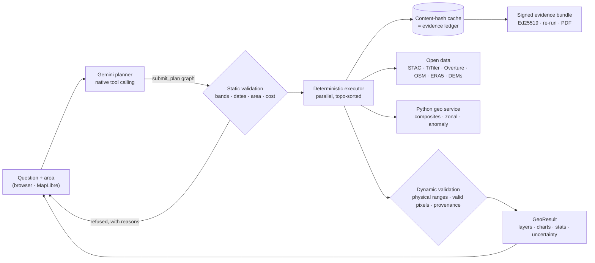

<p align="center">
  
</p>

<h3 align="center">An AI field scientist for the whole planet, one that shows its work and knows when it can't know.</h3>

<p align="center">
  Gemini-planned · deterministic engine · free open satellite data · every number signed and reproducible
</p>

<p align="center">
  <a href="https://erdfeld-web-707586221016.us-central1.run.app"><b>Live demo</b></a> · runs on Google Cloud Run, Gemini 3.8 Flash
</p>

---

**Erdfeld AI** turns a plain-language question about any place on Earth into a verified, mapped,
cited answer, computed from the same free satellite archives that scientists use.

Draw an area, or drop in a shapefile, and ask:

> *"What went under water in the 2025 Sutlej flood, and what did it hit?"*
> *"Was this plot cleared after 2020?"*
> *"Is this September's vegetation unusual for this field?"*

Gemini plans the analysis as a graph of registered geospatial operations. A deterministic engine
validates the plan, pulls Sentinel-1 radar, Sentinel-2 and Landsat optical imagery, elevation models,
OpenStreetMap, Overture buildings and ERA5 weather, and runs the computation. It checks every result
for physical plausibility and returns map layers, charts and an answer in which every sentence points
at the measurement behind it.

It's like having a QGIS power user, a remote-sensing scientist and a fact-checker in the browser,
and none of them makes numbers up.

## Why it is different

Most "ask the map" agents let a language model narrate pixels. Erdfeld AI never lets the model compute anything.

| | Typical AI map chat | Erdfeld AI |
|---|---|---|
| Who produces the numbers | The LLM, from vibes and captions | Registered, versioned operations on real rasters and vectors |
| Bad request ("band B99", a 10 m species map) | A confident hallucination | Refused in milliseconds, with the reason and the valid alternatives |
| Cloudy imagery, failed download | "No data found", or a made-up value | `failed` is never reported as "no data"; cloudy scenes are rejected per pixel and the scenes checked are listed |
| Uncertainty | Single number | Ranges, sensitivity sweeps, confidence and validation status on every result |
| Can I trust it later? | Screenshot | Content-hash result IDs, an evidence ledger, a node-by-node re-run, and an **Ed25519-signed evidence bundle** with an offline verifier |
| When the data can't answer | It answers anyway | **"Cannot determine"**, a first-class verdict |

## What it can do

- **Ask the map anything.** 31 registered operations in 8 domains cover any Sentinel-2/Landsat band or band-math index, cloud-masked composites, radar, terrain derivatives, land cover, surface water, built-up areas, active fires, change and deforestation detection, weather history, OSM queries, field delineation, vectorising, charts and styling. A few more (object detection, segmentation, forecasting) stay off unless their keys or flags are set.
- **Flood mapping from radar.** Sentinel-1 before and after the event, a water threshold with a sensitivity range, and the flooded buildings and roads from Overture. It sees through cloud, which is exactly when floods happen.
- **Claim verification.** Versioned recipes (`not_cleared_since`, `flooded_on`) return **Supported / Contradicted / Cannot determine** with a confidence, an evidence timeline and an explanation built only from recorded results.
- **Batch verification at portfolio scale.** Upload hundreds of plots (GeoJSON, Shapefile, KML, CSV). They run on a crash-safe Postgres job queue, and you export the verdicts as CSV, GeoJSON, KML or Shapefile, or as a zip of signed bundles.
- **"Is this unusual?"** The observed index is compared with the expected range from the site's own history.
- **Cloud-free composites.** A per-pixel median of every clear observation in a time window.
- **Bring your own data.** Import GeoJSON, Shapefile, KML, KMZ, GPX or CSV, reprojected and validated, use it as the study area, and export it back.
- **15,653 datasets, searchable offline.** The agent finds and reads the right open dataset for the question.
- **One-click layers.** True colour, NDVI and elevation, with no model round-trip.

## Measured, not claimed

Every figure here has a method and raw data in [`eval/RESULTS.md`](eval/RESULTS.md), [`eval/PERF.md`](eval/PERF.md) and [`eval/OPS.md`](eval/OPS.md), or comes from the test gate.

| | Result |
|---|---|
| Deforestation claims (`not_cleared_since`), 250 Hansen-labelled plots across 5 biomes | **81% accuracy on answered plots** (95% CI 74–86%), 73% coverage, calibration error (ECE) **0.094**. It abstains rather than guesses on the rest |
| 2025 Sutlej flood, Sentinel-1 radar | **18.1–34.5 km² newly flooded** across the −18 to −15 dB thresholds (219.4 km² observed, scenes 30 Jul and 4 Sep 2025), with 238 buildings and 19.0 km of road hit at −15 dB. One live run, result `r_36e6ecc2acef03c8` (16 Oct 2026). Radar misses flooding under vegetation, so these are lower bounds |
| Dataset search | **hit@5 0.961** on held-out questions over 15,653 datasets |
| Anomaly detection | Expected-range coverage **83%** (p10–p90) on a 6-site, 9-year backtest. Google's TimesFM was benchmarked head-to-head and is off by default because it didn't beat the baseline here. We publish the losses too |
| Live operations check | **43 pass, 3 partial, 0 fail** over 46 cases on the live app (16 Oct 2026): every one of the 31 registered operations plus 3 quick layers, with map tiles fetched and decoded. The partials are honest: no FIRMS key, no vision model configured, one coverage hole |
| Repeat run | An identical repeat returns from the app cache in **0.03–0.07 s** with no upstream requests; every result is content-addressed |
| Job queue | Postgres leases with fencing: concurrent claimers never share a job, a lost worker's job is retried and completes, and a batch settles exactly once (database tests in `src/lib/jobs/__tests__`) |
| Test suite | **2,681 unit, integration and database tests** and **42 Playwright end-to-end tests**, plus typecheck, lint and build, all green on `889ea56` (16 Oct 2026) |

## How it works



- **The model plans and the engine measures.** Gemini emits a `submit_plan` graph whose steps reference each other's outputs. The whole graph is validated before a single byte is fetched.
- **One result schema.** Every operation returns a `GeoResult` carrying layers, Vega-Lite charts, stats, provenance (sources, scene IDs, method), uncertainty and a validation status (`ok`, `flagged`, `refused`, `failed`). The UI renders from specs and has no per-tool code paths.
- **Content-addressed results.** `result_id = hash(operation@version, args, area, data items)` is both the cache key and the ledger entry, so every figure traces back to its inputs.
- **Claims are data, not code.** Recipes are versioned YAML plans with declarative decision rules (`recipes/`), so thresholds never hide in code.

## Built on Google

| | |
|---|---|
| **Gemini** (`@google/genai`) | Five jobs, none of them arithmetic. **Plans** the analysis by native function calling over the operation registry (multi-turn, thought signatures, per-phase thinking level, retries, a model fallback chain). In the investigator it **proposes** competing explanations and their priors, **reads** rendered Sentinel-2 chips (a capped vote), and **searches** with Google Search grounding for dated reports, which are shown as context and never move a belief. It **writes** the cited answer: each figure must cite the recorded result it came from |
| **Gemma 4** | Open-weights planner option on the same adapter, for on-premise and sovereign deployments |
| **Google Cloud Run** | Web app, Python geo service (IAM-authenticated: only the web service's identity may invoke it) and our own TiTiler raster server |
| **Compute Engine · Cloud SQL** | Postgres 16 for the evidence ledger and job queue. The live demo runs it on an always-free e2-micro VM reached over Direct VPC egress; the production profile (`PROFILE=paid` in [`deploy/cloudrun/common.sh`](deploy/cloudrun/common.sh)) uses Cloud SQL |
| **Secret Manager · Artifact Registry · Cloud Build** | Server-held keys, container images and their builds. Deploy scripts are in [`deploy/cloudrun/`](deploy/cloudrun/) |
| **Earth Engine** (optional) | An alternative raster backend behind a flag |

## Stack

Next.js 16 · TypeScript · MapLibre GL · Vega-Lite · Zustand · PostgreSQL 16 + Prisma · FastAPI + rasterio (uv) · TiTiler · Vitest · Playwright.

## Quickstart

Prerequisites: Node 22+, PostgreSQL 16 server binaries (`initdb`, `pg_ctl`), and a [Gemini API key](https://aistudio.google.com/apikey).

```bash
git clone https://github.com/AbdulHannanF/erdfeld-ai.git && cd erdfeld-ai
npm ci --ignore-scripts && npm rebuild esbuild sharp unrs-resolver @prisma/client prisma
npx prisma generate
cp .env.example .env              # add GEMINI_API_KEY; DATABASE_URL is preset for the dev cluster
scripts/dev-db.sh                 # local PostgreSQL 16 on :5433
npx prisma migrate deploy
npm run dev                       # http://localhost:3000
```

Open the **Erdfeld** tab in the right-hand panel and pick a sample case, or draw an area and ask. For composites and anomaly
detection, also run the geo service: `cd services/geo && uv sync && uv run uvicorn app.main:app --port 8100`
and set `GEO_SERVICE_URL=http://127.0.0.1:8100`.

## Configuration

Everything is optional except `DATABASE_URL` and a model key. The ones you're most likely to need:

| Variable | Purpose |
|---|---|
| `GEMINI_API_KEY` | Server-held Gemini key; makes Gemini the default planner |
| `GEO_SERVICE_URL` | Python geo service (composites, time series, anomaly) |
| `TITILER_ENDPOINT` | Your own TiTiler (defaults to the public one) |
| `EVIDENCE_SIGNING_KEY` | A durable Ed25519 key, so signed bundles verify across restarts |
| `FIRMS_MAP_KEY` | NASA FIRMS active fires |

The full list, with comments, is in [`.env.example`](.env.example). Secrets never go in git; a
pre-commit scan (`scripts/check-secrets.mjs`) enforces it.

## Development

```bash
npx tsc --noEmit && npx vitest run && npx eslint . && npx next build   # the gate before every commit
DATABASE_URL_TEST=postgresql://geoagent@127.0.0.1:5433/geoagent_test npx vitest run   # include database suites
npx playwright test                                                      # end-to-end, needs the standalone build
cd services/geo && uv sync && uv run pytest                              # Python service
npx tsx scripts/verify-bundle.mts <bundle.json>                         # verify a signed evidence bundle offline
```

## Honest limits (by design)

Free imagery is about 10 m per pixel. Erdfeld AI won't identify tree species, count cars or trace
sub-metre parcels, and it will tell you so instead of pretending. Radar flood thresholds depend on
the scene, so flood areas come with a range. It is a reconnaissance and verification instrument, not a
survey-grade one. Anything without a measurement in [`eval/`](eval/) is not a claim.

## License

No license has been chosen yet; all rights reserved until one is added.
